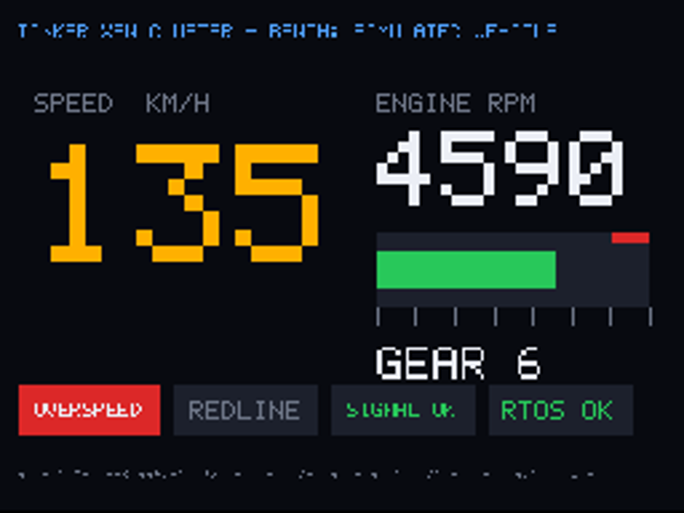

# My Tinker Board Project: Three Operating Systems on One Small Computer

*A beginner's guide to how this project was built, step by step, from the first boot to the end.*

---

## Before you start

This guide tells the whole story of the project, from the very first boot problem to the finished
system. You don't need to be an expert to read it. Every new word is explained the first time it
appears, and there's a word list at the end ([Chapter 15](#chapter-15--word-list)).

If you want the exact technical details (register addresses, full patch listings, every hash), they
are in `TECHNICAL-REFERENCE.md` in the same folder. This guide is the friendly version.

**How to read it:**
- Chapters 1–3 explain the ideas and the equipment. Read these first.
- Chapters 4–10 tell the story in order. Each step answers four questions:
  *What did we want? What went wrong? Why? How did we fix it?*
- Chapters 11–14 are for using the finished system and getting out of trouble.

---

## Contents

- [Our journey at a glance](#our-journey-at-a-glance) (the whole project as one tree)

1. [The big idea](#chapter-1--the-big-idea)
2. [The equipment](#chapter-2--the-equipment)
3. [The building blocks, explained simply](#chapter-3--the-building-blocks-explained-simply)
4. [Setting up the build PC](#chapter-4--setting-up-the-build-pc)
5. [Part 1 – Getting Xen to start](#chapter-5--part-1--getting-xen-to-start)
6. [Part 2 – Making it a real system](#chapter-6--part-2--making-it-a-real-system)
7. [Part 3 – Adding Android](#chapter-7--part-3--adding-android)
8. [Part 4 – Polishing it](#chapter-8--part-4--polishing-it)
9. [Part 5 – The car project](#chapter-9--part-5--the-car-project)
10. [Part 6 – Four domains, a screen for each, Android 10](#chapter-10--part-6--four-domains-a-screen-for-each-android-10)
11. [How the finished system works](#chapter-11--how-the-finished-system-works)
12. [How to build, flash and use it](#chapter-12--how-to-build-flash-and-use-it)
13. [Every problem we hit, in plain words](#chapter-13--every-problem-we-hit-in-plain-words)
14. [What doesn't work yet, and how to recover](#chapter-14--what-doesnt-work-yet-and-how-to-recover)
15. [Word list](#chapter-15--word-list)

---

## Our journey at a glance

The whole project as one tree, in the order we did it. Each branch is one step from Chapters 5–10:
first what went wrong (✗), then what fixed it (→). Steps without a problem just say what we built.

```
Tinker Board RK3288 project
│
├── Start: build a Yocto image on the PC (Chapter 4)
│
├── Part 1 – Getting Xen to start (Chapter 5)
│   ├── Step 1   ✗ Board "froze" after mmcblk0: p1 … p9
│   │            → The card held an old project; flash our own image
│   ├── Step 2   ✗ Typing did nothing
│   │            → Serial wires to pins 32 / 33 / 34 (not 8 / 10)
│   ├── Step 3   ✗ "Xen must be entered in NS Hyp mode"
│   │            → U-Boot patch 0001: switch to non-secure HYP mode
│   ├── Step 4   ✗ Silence after "Starting kernel"
│   │            → Same U-Boot patch: clean HYP settings register
│   ├── Step 5   ✗ "Missing processor info: 410fc0d1"
│   │            → Xen patch 0001: add the Cortex-A12/A17
│   ├── Step 6   ✗ dom0 Linux crashed twice (L2CTLR, DMA controller)
│   │            → Xen patch 0002 + non-secure DMA address in the start script
│   ├── Step 7   ✗ The 2-second hang (Xen's clock went backwards)
│   │            → Linux patch 0001: don't reset timer7
│   └── Result   ✓ Xen + dom0 boot, login works
│
├── Part 2 – Making it a real system (Chapter 6)
│   ├── Step 8   First test guest with xl create
│   ├── Step 9   Network bridge xenbr0 (192.168.100.x)
│   ├── Step 10  FreeRTOS as a guest (rtos1), 1 ms tick
│   ├── Step 11  ✗ FreeRTOS up to 19 ms late
│   │            → RTDS real-time scheduler: 200 µs in every 1 ms
│   ├── Step 12  ✗ reboot hung
│   │            → Xen patch 0003: RK3288 reset
│   ├── Step 13  Xen starts by itself at power-on (/boot.scr)
│   └── Step 14  ✗ Only 1 CPU core
│                → U-Boot patch 0002: PSCI → 4 cores
│
├── Part 3 – Adding Android (Chapter 7)
│   ├── Step 15  Android 7 + its own 4.14 kernel (32-bit binder)
│   ├── Step 16  Android adapted to Xen (disks, init.xen.rc, network)
│   ├── Step 17  ✗ system_server kept crashing
│   │            → 3 fixes: /dev/input folder, alarm (timerfd) patch, USB hub kept awake
│   └── Step 18  ✗ Xen crash with RTDS on all 4 cores
│                → FreeRTOS alone on core 3 (cpupool rt); real fix in Step 28
│
├── Part 4 – Polishing it (Chapter 8)
│   ├── Step 19  Quieter FreeRTOS, release Xen, auto-start, watchdog, NAT …
│   ├── Step 20  ✓ Repeated power-cycle test passed
│   └── Step 21  Screen + touch for Android tried → froze → switched off (headless)
│
├── Part 5 – The car project (Chapter 9)
│   ├── Step 22  Pretend car vehicle-sim on vcan0
│   ├── Step 23  can2rtos: CAN → FreeRTOS (receive only)
│   ├── Step 24  FreeRTOS checks speed, rpm and signal loss
│   ├── Step 25  Dashboard on HDMI (cluster-hdmi)
│   ├── Step 26  ✗ Messages arrived in bursts (105 ms gaps)
│   │            → FreeRTOS signals xenconsoled less often → 20–35 ms
│   ├── Step 27  ignition-watch (switched off until ACC is wired)
│   └── Step 28  ✗ Xen crash in the RTDS scheduler
│                → Xen patches 0004 + 0005 (official fixes), 3000-round test ✓
│
└── Part 6 – Four domains, a screen for each, Android 10 (Chapter 10) – tested on the board, except screens + Android 10
    ├── Step 29  ✗ "Android 17" can't run on a 32-bit 2 GB chip
    │            → newest possible: 7.1.1 ready-made, 9/10 from source → chose 10 (LineageOS 17.1)
    ├── Step 30  Smaller dom0: 384 MB, ffmpeg moved out (320 MB in Step 37)
    ├── Step 31  FreeRTOS gets all of core 3 (1000 µs in every 1000 µs)
    ├── Step 32  New 4th domain media1: Yocto video + picture player
    ├── Step 33  display-map: one screen per OS (HDMI + USB displays, udl)
    ├── Step 34  SSH (dropbear) + tmux consoles for every OS
    ├── Step 35  Android 10 (LineageOS 17.1): PC set up, source downloaded, build next
    │            ✗ 3 WebView packages failed → git-lfs;  ✗ swap lost by a "!" → re-run
    ├── Step 36  Safety check: heat, power, SD card, memory
    ├── Step 37  Every OS smaller: card 3.54 → 1.57 GB, memory 1168 → 1028 MB
    │            (QEMU firmware 220 MB out, Android system 1.8 GB → 613 MB, rtos1 4 MB)
    └── Step 38  ✓ Tested on the board: all 4 domains, rtos1 1000/1000 µs, Android + media1 work

Finished (Part 5): Xen → dom0 (Yocto) + FreeRTOS (real-time) + Android, on 4 cores
Next (Part 6):     + media1 (Yocto media), a screen per OS, Android 10
```

---

## Chapter 1 – The big idea

### What we built

We took one small, cheap computer board, the **ASUS Tinker Board R2.0**, and made it run
**three operating systems at the same time**:

1. **Linux** (made with Yocto). This is the "boss". It controls everything else.
2. **Android 7**. The same system phones use. Here it runs without a screen.
3. **FreeRTOS**. A tiny "real-time" system that must react on time, every time.

They all run together, on the same board, and they can't disturb each other.

### Why would anyone do that?

Think about a modern car. It has a computer for the music and maps, a computer for the
dashboard, and computers for safety (like the brakes). Car makers now want to put all of those on
**one chip** to save money and space. But the safety part must never be slowed down or crashed by
the music app.

The trick is a program called a **hypervisor**. It sits underneath all the operating systems and
gives each one its own share of the computer, like walls between flats in a building. We used the
hypervisor called **Xen**.

```
     Linux (boss)        Android (apps)      FreeRTOS (safety, on time)
   ┌──────────────┐    ┌──────────────┐    ┌──────────────┐
   │              │    │              │    │              │
   └──────────────┘    └──────────────┘    └──────────────┘
   ┌────────────────────────────────────────────────────────┐
   │           Xen hypervisor (the walls between them)      │
   └────────────────────────────────────────────────────────┘
   ┌────────────────────────────────────────────────────────┐
   │      Tinker Board: 4 CPU cores, 2 GB memory            │
   └────────────────────────────────────────────────────────┘
```

### What you get at the end

You put the SD card in the board and switch it on. Without pressing anything:

- Xen starts, then Linux, then Android and FreeRTOS start by themselves.
- FreeRTOS runs a task exactly every 10 milliseconds. We measured it: it's never more than
  0.04 ms early or late, even while Android is busy.
- A pretend car sends its speed and engine speed (rpm) 100 times a second. FreeRTOS checks every
  message and warns about speeding, about the engine revving too high, and about the signal going
  missing.
- If you plug in an HDMI monitor, a car dashboard shows the speed, rpm and warning lights.

The project took four days, 2026-10-22 to 2026-10-25.

---

## Chapter 2 – The equipment

### What you need

- **ASUS Tinker Board R2.0.** It has a Rockchip **RK3288** chip with 4 CPU cores and 2 GB of memory.
- **A micro-SD card**, 32 GB. The whole system lives on this card.
- **A USB-to-serial adapter** (3.3 V). This lets the PC read the board's text messages and type
  into it, even before anything has started. We call this the **console** or **UART**.
- **A good power supply**: 5 V, 3 A. A weak one causes strange freezes (we saw two).
- **A Linux PC.** We used Ubuntu. It builds the software and writes the SD card.
- Optional: an HDMI monitor, an Ethernet cable, a USB CAN adapter (for reading a real car).

### Connecting the serial adapter (important!)

This was the first thing that went wrong, so take care here. The board has a row of 40 pins. The
console is on pins **32, 33 and 34**, not on pins 8 and 10 as many websites suggest for other boards.

```
   Board pin 32 (sends)    ───────►  adapter RX (receives)
   Board pin 33 (receives) ◄───────  adapter TX (sends)
   Board pin 34 (ground)   ────────  adapter GND
```

Notice that "send" goes to "receive" and the other way round.

On the PC, open the console with:

```
picocom -b 115200 /dev/ttyUSB0
```

`115200` is the speed. Press `Ctrl-a` then `Ctrl-x` to quit picocom.

> **Remember:** when the board starts, it shows "Hit any key to stop autoboot" for a moment. If you
> press a key then, it stops and waits. So after switching on, **don't touch the keyboard** until
> you see `login:`.

---

## Chapter 3 – The building blocks, explained simply

Here are all the pieces, from the bottom up, the order in which they start.

### The boot ROM and U-Boot (the "starter")

When you switch on, a tiny program built into the chip (the **boot ROM**) looks at the SD card and
loads **U-Boot**. U-Boot is a **bootloader**: its only job is to prepare the hardware and start the
next program. Think of it as the starter motor of a car.

### Xen (the hypervisor)

Xen is started by U-Boot. It takes over the CPU cores and memory and shares them out.

One thing is important to know. An ARM processor has different "levels of power", called **modes**.
Normal programs run at the lowest level. Operating systems run one level higher. A hypervisor needs
an even higher level, called **HYP mode**. U-Boot has to hand the CPU over *in HYP mode*, or Xen
refuses to start. This turned out to be our biggest problem (Chapter 5).

### Domains (the virtual machines)

Xen calls each operating system it runs a **domain**.

- **Domain-0 ("dom0")** is the boss domain. It's Linux, and it can create, stop and watch the
  others. It is the only one that touches the real hardware (SD card, network, USB).
- The other domains are **guests**. Ours are `android1` (Android) and `rtos1` (FreeRTOS).

### Yocto (the "factory" that builds Linux)

You don't download Linux for this board as a ready file. You **build** it with a tool called
**Yocto**. Yocto reads "recipes" (small text files) that say where to download each program, how to
compile it and where to put it. At the end it produces one file you can write to the SD card: the
**image** (`.wic` file).

Recipes are grouped into **layers**. We didn't change anyone else's layers. All our own work is in
one layer of our own called **`meta-tinker-xen`**. That keeps everything tidy: if you delete our
layer, you're back to the original.

Words you'll see:
- **recipe** (`.bb` file): how to build one program.
- **bbappend** (`.bbappend` file): "take that other recipe, and also do this". We use it to add our
  fixes to U-Boot, Xen and Linux without editing their files.
- **patch** (`.patch` file): a small list of changes to source code ("in this file, replace these
  lines with those lines").
- **bitbake**: the command that runs the factory, e.g. `bitbake tinker-xen-test-image`.

### Real-time and FreeRTOS

"Real-time" doesn't mean "fast". It means **on time, every time**. An airbag must fire within a few
milliseconds; being fast "on average" isn't good enough. **FreeRTOS** is a very small operating
system designed for this. Ours runs a task every 10 ms and measures how accurate it is.

### Schedulers (who gets the CPU when)

When several programs want the same CPU, a **scheduler** decides who goes next. Xen has several:

- **credit2**: fair sharing. Good for Linux and Android.
- **RTDS**: real-time. You say "this guest gets 200 microseconds of CPU in every 1 millisecond,
  guaranteed", and Xen keeps that promise.

We gave FreeRTOS its **own CPU core** (core number 3) with RTDS, and the other three cores to Linux
and Android with credit2. A group of cores with its own scheduler is called a **cpupool**.

### CAN bus

Cars send messages between their computers on a two-wire network called **CAN**. Each message has
a number (its ID) and up to 8 bytes of data. Linux can use CAN like a network card. It even has a
*pretend* one, called **vcan**, that we used for testing.

---

## Chapter 4 – Setting up the build PC

These steps happen on the PC, not on the board.

**Step 1 – Download Yocto and the layers it needs.** All on the "kirkstone" version:

```
mkdir ~/yocto-rk3288 && cd ~/yocto-rk3288
git clone -b kirkstone git://git.yoctoproject.org/poky
git clone -b kirkstone https://github.com/openembedded/meta-openembedded
git clone -b kirkstone git://git.yoctoproject.org/meta-virtualization
git clone -b kirkstone git://git.yoctoproject.org/meta-arm
git clone -b kirkstone git://git.yoctoproject.org/meta-rockchip
```

What each one is:
- `poky`: Yocto itself.
- `meta-openembedded`: lots of extra programs.
- `meta-virtualization`: Xen.
- `meta-arm`: the ARM compiler.
- `meta-rockchip`: support for the Tinker Board's chip.

**Step 2 – Make a build folder and tell Yocto about the layers:**

```
source poky/oe-init-build-env build
bitbake-layers add-layer ../meta-openembedded/meta-oe
bitbake-layers add-layer ../meta-arm/meta-arm-toolchain ../meta-arm/meta-arm
bitbake-layers add-layer ../meta-rockchip
bitbake-layers add-layer ../meta-openembedded/meta-filesystems
bitbake-layers add-layer ../meta-openembedded/meta-python
bitbake-layers add-layer ../meta-openembedded/meta-networking
bitbake-layers add-layer ../meta-virtualization
bitbake-layers add-layer ../meta-tinker-xen
```

**Step 3 – Tell Yocto which board and which features.** Open `build/conf/local.conf` and make sure
it has these two lines:

```
MACHINE = "tinker-board"
DISTRO_FEATURES:append = " virtualization xen"
```

**Step 4 – Build:**

```
bitbake tinker-xen-test-image
```

The first build takes several hours, because it compiles everything from scratch. Later builds only
redo what changed and take minutes. When it works, the last line says something like
`all succeeded`. The SD card file ends up in
`build/tmp/deploy/images/tinker-board/tinker-xen-test-image-tinker-board.wic`.

> **Tip:** before changing anything, we saved a copy of the original, working image in
> `diagnostics/baseline/`. If everything goes wrong, you can always go back to it.

---

## Chapter 5 – Part 1 – Getting Xen to start

This was the hardest part. Xen had never run on this chip, and seven different things stood in the
way. We removed them one by one.

### Step 1 – The "freeze" that wasn't our image

**What we saw:** the board stopped after a line listing the SD card's partitions
(`mmcblk0: p1 … p9`).

**Why:** we counted. Our image has 7 partitions, but the message showed 9, and the bootloader
version was different too. The card held a completely different, older project, not our Yocto
image. That old project had a hang ~2 seconds into Linux, which we met again (and fixed) in Step 5.

**Fix:** write our own image to the card.

### Step 2 – Typing did nothing

**What we saw:** the board's messages appeared on the PC, but nothing we typed reached the board.

**Why:** the adapter's wires were on pins 8 and 10, which is a different serial port.

**Fix:** move the wires to pins 32, 33 and 34 (Chapter 2). Then we could log in.

### Step 3 – "Xen must be entered in NS Hyp mode"

**What we saw:** Linux on its own showed this line:

```
CPU: All CPU(s) started in SVC mode.
```

and Xen, started by hand from U-Boot, stopped immediately:

```
- Xen must be entered in NS Hyp mode -
- Please update the bootloader -
- Boot failed -
```

**Why:** remember the "levels of power" from Chapter 3. U-Boot handed over the CPU in "SVC mode"
(the operating-system level) and in "secure" state. Xen needs "HYP mode" in "non-secure" (NS)
state. U-Boot can do this switch for some chips, but nobody had ever written that code for the
RK3288.

**Fix:** we wrote it ourselves, in a U-Boot patch
(`0001-rockchip-rk3288-allow-booting-in-non-secure-HYP-mode.patch`). It does four things:

1. It tells U-Boot that this chip *can* do the switch.
2. It tells U-Boot where the interrupt controller (the GIC) is.
3. It opens up the chip's devices to "non-secure" programs. Normally many devices only listen to
   "secure" programs, so Xen and Linux would be locked out.
4. It **keeps the old behaviour as the default**. The switch only happens when our Xen start script
   asks for it, so plain Linux still boots exactly as before.

> **Safety note:** a broken bootloader can stop a board from starting. So we tested every new U-Boot
> by sending it over the serial cable straight into memory (`loady`) and starting it from there.
> Nothing was written to the card until it worked. Since the board starts from the SD card, the worst
> case is always "write the card again".

### Step 4 – Silence after "Starting kernel"

**What we saw:** after the patch, the board printed `Starting kernel ...` and then nothing at all.

**Why:** after a lot of detective work (we made the code print a letter at each step and saw it stop
at "E"), we found the cause. When the CPU enters HYP mode, it uses a settings register that nobody
had set, so it contained random leftovers. Those leftovers switched on features that made the very
first instruction crash.

**Fix:** set that register to a clean, known value just before switching (`0x30c50830`). Added to
the same U-Boot patch.

### Step 5 – Xen didn't know the processor

**What we saw:** `Missing processor info: 410fc0d1`.

**Why:** Xen keeps a list of processors it knows. The RK3288's CPU type (Cortex-A12/A17) wasn't on
the list, not even in the newest Xen.

**Fix:** a Xen patch (`0001`) that adds it, set up the same way as its close cousin, the Cortex-A15.

### Step 6 – Linux (dom0) crashed in two places

**Crash 1:** Linux crashed while reading a cache-control register called L2CTLR. Under Xen, reading
that register is "caught" by Xen, and Xen didn't know what to answer, so it reported an error.
**Fix:** Xen patch `0002`. Xen now answers with the real value, the same way the KVM hypervisor
does.

**Crash 2:** Linux crashed when touching a DMA controller (a helper that copies memory). It was
using the controller's "secure-only" address. **Fix:** our start script tells Linux to use the
controller's normal address instead.

### Step 7 – The famous 2-second hang

**What we saw:** Linux always stopped about 2 seconds after starting. This was the same hang the old
project on the card had.

**Why:** this one took the longest. Xen printed its internal clock, and the number was **negative**.
Time was going backwards! We found that Linux, while starting, **resets a hardware timer** (timer7),
and on this chip that timer drives the main system clock. Linux didn't mind, but Xen's clock jumped
back to zero, so every "wake me up in 1 second" alarm in Xen would never ring. Everything waited
forever.

**Fix:** a small Linux patch: "if timer7 is already running, leave it alone". U-Boot always starts
it, so Linux now never resets it.

### Result of Part 1

```
/sys/hypervisor/type  →  xen
```

Linux was running **on top of Xen** for the first time on this board.

---

## Chapter 6 – Part 2 – Making it a real system

### Step 8 – The first guest

We installed Xen's control tools (`xl`) and created a small test Linux as a guest. Commands:

```
xl create /etc/xen/guest1.cfg     # start a guest
xl list                           # see all domains
xl console guest1                 # talk to it (Ctrl-] to come back)
xl destroy guest1                 # switch it off
```

It worked. (We removed this test guest later, when Android arrived.)

Once, the board restarted by itself the moment we started a guest. It never happened again. The
reset reason said "power-on", so it was most likely a weak moment of the power supply.

### Step 9 – A network between the domains

We built a **bridge**, a virtual network switch inside dom0, called `xenbr0`, with the address
`192.168.100.1`. Each guest gets a virtual network cable plugged into it. A ping between Linux and
the guest worked in both directions, in under 1 millisecond.

### Step 10 – FreeRTOS as a guest

**Why FreeRTOS and not Zephyr?** Zephyr's Xen support only works on 64-bit ARM, and our chip is
32-bit.

We wrote the small "glue" FreeRTOS needs to live inside Xen. Xen gives every guest a virtual
interrupt controller and a virtual timer, and our code uses them to make the 1 ms "tick" that drives
FreeRTOS. The guest prints its results as text.

The first runs showed three bugs:

| What we saw | Why | Fix |
|---|---|---|
| The same text line printed again and again | memory caches were off, so Xen read old data | switch the caches on |
| Each 10 ms period was really 10.15 ms | each tick was timed from "now", so small delays added up | time each tick from a fixed schedule instead |
| FreeRTOS used 100 % of its CPU | when idle, it spun in a loop | when idle, it now sleeps (`WFI` instruction) |

After that: **10 ms, accurate to about 0.008 ms**.

### Step 11 – The real-time scheduler

With everything sharing one core, FreeRTOS was sometimes 19 ms late while the other guest started.
That's terrible for real-time. So we switched FreeRTOS to the **RTDS** scheduler and gave it a
guarantee: *200 µs in every 1 ms*.

```
xl sched-rtds -d rtos1 -v all -p 1000 -b 200 -e 1
#   -p period 1000 µs, -b budget 200 µs, -e may use spare time too
```

Results:

| Situation | Before (credit2) | After (RTDS) |
|---|---|---|
| Nothing else happening | ±0.008 ms | ±0.01–0.02 ms |
| Another guest starting | up to 19.9 ms late | mostly under ±0.115 ms |
| Linux 100 % busy | – | ±0.007 ms |

### Step 12 – `reboot` didn't work

**What we saw:** typing `reboot` printed `Xen: Platform reset did not work properly!` forever.

**Why:** Xen didn't know how to reset this particular chip.

**Fix:** Xen patch `0003` teaches Xen about the RK3288. To reset, it writes the magic value `0xfdb9`
into the chip's reset register, the same thing Linux and U-Boot do. The first version couldn't find
that register. Our board is the "RK3288**W**" variant, and U-Boot renames the device on it, so the
patch now accepts both names.

### Step 13 – Starting Xen automatically

Until now we started Xen by typing commands into U-Boot. To make it automatic, we used something
U-Boot already does: at power-on it looks on the card's boot partition for a file called
`/boot.scr` and runs it. So we:

- put our Xen start script there as `/boot.scr`;
- made sure the image doesn't contain the file U-Boot would otherwise prefer
  (`/extlinux/extlinux.conf`);
- kept a "plain Linux without Xen" option in `/native/extlinux.conf`, used if Xen is missing.

We never used `saveenv`, so U-Boot's own settings were never changed.

### Step 14 – Using all 4 CPU cores

**What we saw:** `Failed to bring up CPU 1 (error -19)`. Xen used only one core.

**Why:** Xen starts the other cores by asking the firmware through a standard interface called
**PSCI** ("please switch on core 2, and start it at this address"). This board had no PSCI.

**Fix:** we added PSCI to U-Boot (patch `0002`). U-Boot leaves a tiny piece of itself in memory, and
when Xen asks to switch on a core, that piece:

1. powers the core up,
2. writes the start address and a magic number (`0xdeadbeaf`) into a "mailbox" the chip's boot ROM
   watches,
3. wakes the core.

**Problem on the first try:** only 2 cores came up. All the sleeping cores watch the *same*
mailbox, so the first request woke all of them at once. **Fix:** switch the extra cores fully off
first, so each request wakes exactly one.

Result:

```
(XEN) Using PSCI v1.0
(XEN) Brought up 4 CPUs
```

---

## Chapter 7 – Part 3 – Adding Android

### Step 15 – Why Android 7, and why a special kernel

Google publishes ready-made Android images for 32-bit ARM only up to Android 7. Building Android
yourself needs about 250 GB of disk, more than our PC had free.

Android 7 talks to its kernel through a part called **binder**, using an old 32-bit format. That old
format was removed from Linux after version 4.18, and our dom0 Linux is 5.15. So Android gets **its
own kernel, Linux 4.14**, built by the recipe `linux-android-guest`.

### Step 16 – Adapting Android to Xen

The downloaded image was made for the Android phone emulator. We changed a few things:

- **Disks:** Android's `/system` and `/data` live on two extra SD card partitions (p8 and p9). Xen
  passes them to Android as virtual disks.
- **Startup file:** a new `init.xen.rc` tells Android how to start inside Xen (mount the disks,
  start the network, enable adb).
- **Graphics:** the emulator's graphics files were removed, and Android uses its built-in software
  drawing.
- **Network:** Android gets the address `192.168.100.3`, and dom0 is its gateway to the outside.

You talk to Android from dom0 with **adb** (Android Debug Bridge):

```
adb connect 192.168.100.3:5555
adb shell
```

### Step 17 – Android kept crashing at start

Android's main program (`system_server`) crashed and restarted again and again. We fixed it in
three rounds:

1. **Error:** `Could not register INotify for /dev/input`.
   **Why:** there's no keyboard or touchscreen, so the input folder was never created.
   **Fix:** create the folder at startup (`mkdir /dev/input` in `init.xen.rc`).

2. **Error:** a `NullPointerException` in the alarm service.
   **Why:** Android 7 sets its alarms in a way that needs a special permission. Android only got
   that permission in version 8, and the old way (a `/dev/alarm` device) doesn't exist in Linux
   4.14.
   **Fix:** a small patch to the Android kernel that allows alarms for Android's "system" user group
   (number 1000).

3. **Error:** the USB hub kept resetting while adb was running.
   **Why:** the board's USB hub falls asleep to save power and fails to wake up properly.
   **Fix:** a rule that keeps the hub awake.

### Step 18 – A Xen crash, and a clever workaround

**What we saw:** with the RTDS scheduler on all 4 cores, Xen crashed while Android started:

```
Assertion '!unit_on_replq(svc)' failed at rt.c:587
```

**Workaround:** use RTDS only where we really need it. Cores 0–2 got the normal credit2 scheduler
(for Linux and Android), and core 3 got its own pool, called `rt`, with RTDS just for FreeRTOS. This
is actually a nicer design anyway. (The real cause of this crash came back later and was properly
fixed in Step 28.)

**Result:** Android started fully (`sys.boot_completed = 1`) with zero crashes, and FreeRTOS stayed
accurate to ±0.06 ms while Android was busy.

---

## Chapter 8 – Part 4 – Polishing it

### Step 19 – Small but important improvements

- **Quieter FreeRTOS.** It printed 3 lines per second on the shared console, so you couldn't type.
  Now it prints one summary line every 10 seconds.
- **Faster, final Xen.** We switched from the "debug" Xen (extra checks, lots of messages) to the
  normal "release" Xen. The release build left out the real-time scheduler by default, so we turned
  it back on (`CONFIG_SCHED_RTDS=y`).
- **Temperature sensor.** Under Xen, the temperature driver waited forever and gave no readings.
  That also meant no automatic shutdown if the chip overheated. The cause was a link to "CPU cooling"
  that can't exist under Xen. **Fix:** the start script removes that link. Now the readings work
  (about 35–42 °C).
- **FreeRTOS gets a proper console.** Instead of a debug-only trick, it now uses a shared memory
  "ring" like the other guests, so `xl console rtos1` works with the release Xen.
- **Hardware watchdog.** A **watchdog** is a timer that restarts the board unless somebody "pats" it
  regularly. Dom0 now pats it every 5 seconds. If the system freezes, nobody pats it, and the board
  restarts itself after about 45 seconds. We tested it: it restarted after 43 seconds.
- **Guests start by themselves.** A startup script (`xen-guests`) starts FreeRTOS and Android at
  boot, and stops them cleanly at shutdown.
- **No more console spam.** Linux tried to put a login prompt on the serial port, which belongs to
  Xen, and complained `respawning too fast`. Now it doesn't try.
- **Android network service refused to start.** Android's security system (SELinux) said
  `Service xen-net does not have a SELinux domain defined`. **Fix:** tell it which security label
  to use (`seclabel u:r:su:s0`).

### Step 20 – Final check of Part 4

We restarted, powered off and powered on several times. Every time:

1. Xen started with 4 cores.
2. Both guests started on their own.
3. Android was ready about 76 seconds later.
4. FreeRTOS stayed between 9961 and 10038 µs (the target is 10000).

### Step 21 – Trying a screen and touch for Android (switched off again)

We tried to give Android a screen and touch:

- dom0 showed Android's screen on the HDMI monitor;
- a USB touchscreen was passed through to Android;
- sound worked in dom0.

Some of it worked: Android drew its screen and received taps.

**But:** Android's apps need a 3D graphics feature (OpenGL ES 2.0) that this setup doesn't have. We
could force apps to draw without it, but then Android **froze after 1–2 minutes**. We traced it to
Android's timer interrupt getting stuck, but couldn't solve it.

**Decision (yours, option A):** go back to the stable, screen-less Android. The screen and touch
code stays in the project, switched off.

---

## Chapter 9 – Part 5 – The car project

We moved toward a real-time **car system**. To keep it safe, we followed one simple rule:

> **The board never sends anything to a car.** We use a *pretend* car. If it's ever connected to a
> real car, it only *listens*.

### Step 22 – A pretend car

The program **`vehicle-sim`** acts like a car and sends two CAN messages every 10 ms on the pretend
CAN bus `vcan0`:

- message `0x0C0`: speed (in steps of 0.01 km/h);
- message `0x0C1`: engine speed in rpm.

It "drives" a 60-second loop:

```
0–20 s   speed up from 0 to 135 km/h (changing gears)
20–35 s  cruise at 135 km/h  (too fast on purpose: the limit is 120)
35–50 s  brake to a stop
50–60 s  stand still (engine idling at 800 rpm)
```

It shifts late in 2nd gear on purpose, so the engine goes over 6000 rpm.

### Step 23 – Getting the messages into FreeRTOS

FreeRTOS has no CAN driver of its own, so a small dom0 program, **`can2rtos`**, passes the messages
over:

1. It **only receives** CAN messages, and only the two IDs we care about.
2. For each speed message, it writes one simple text line into FreeRTOS's console, like
   `V 1234 13500 4590` (message number, speed, rpm).

### Step 24 – FreeRTOS checks every message

A new FreeRTOS task, **`vVehicleTask`**, runs every 5 ms. It reads the lines and checks:

| Check | Warning when | All-clear when |
|---|---|---|
| Overspeed | above 120 km/h | below 115 km/h |
| Engine redline | above 6000 rpm | below 5700 rpm |
| Signal lost | no message for 100 ms | messages return |

The all-clear is a bit lower than the warning on purpose. This "hysteresis" stops a warning from
flickering on and off when the value sits right at the limit.

If the signal is lost, FreeRTOS marks the speed as invalid instead of showing an old value. That's
the "fail-safe" idea: when in doubt, say "I don't know" rather than show something wrong.

Example of what it prints:

```
[vehicle] ALERT overspeed: 135 km/h (limit 120)
[vehicle] ALERT engine over redline: 6293 rpm (limit 6000)
[vehicle] redline cleared: 5694 rpm
[vehicle] SIGNAL LOST: no frame for 100 ms, speed/rpm invalid
[vehicle] SIGNAL OK again (seq 52011)
[vehicle] 10s: frames 1000, lost 0, bad 0, max gap 25000 us, speed 135 km/h, rpm 4590; ...
```

**Test result:** 1000 messages every 10 s, **0 lost**. All warnings came on and went off at the
right moments, and pausing the pretend car triggered "SIGNAL LOST".

### Step 25 – The dashboard

The program **`cluster-hdmi`** draws a car dashboard on the HDMI monitor:

- big speed numbers and rpm with a bar;
- four warning lamps: OVERSPEED, REDLINE, SIGNAL, RTOS;
- a status line at the bottom.

It reads the CAN messages itself (listen only), and it reads FreeRTOS's warnings from FreeRTOS's log
file.

**Problem:** the RTOS lamp had no data. **Why:** the folder for that log file
(`/var/log/xen/console`) didn't exist after a restart. **Fix:** create it automatically at every
boot.

No monitor was available, so we tested it by drawing into memory and saving a picture. This is the
real picture from the board:



### Step 26 – Messages arriving in bursts

**What we saw:** sometimes FreeRTOS waited **105 ms** between messages. That's dangerously close to
its 100 ms "signal lost" limit, even though the pretend car never paused. On the dom0 side, the
gaps were at most 29 ms.

**Why:** we read the source code of Xen's console program (`xenconsoled`). To protect itself from
noisy guests, it only listens to a guest's "I'm ready for more" signal 30 times per 0.2 seconds. Our
FreeRTOS sent that signal after *every* read, up to 200 times a second. So xenconsoled kept
ignoring it, and the messages piled up and then arrived in a burst.

**Fix:** FreeRTOS now only sends the signal when its input buffer is nearly full. xenconsoled keeps
filling a buffer that has room anyway, without being asked.

**Result:** the biggest gap dropped from 105 ms to **20–35 ms**, still with 0 lost messages.

### Step 27 – Ignition (switched off until wired)

In a real car, the computer should switch itself off cleanly when you turn the key off. The car's
"ACC" wire has 12 V while the key is on.

**`ignition-watch`** reads that signal on board pin 7:

- ACC off for 10 seconds → it shuts the board down cleanly (guests first).
- ACC back on within 10 seconds → it cancels the shutdown. Starting the engine can make the voltage
  dip for a moment.
- It does nothing until it has seen ACC "on" at least once. Without this, a board on your desk with
  nothing connected could switch itself off.

> **Danger:** 12 V would destroy the board's 3.3 V pin. It must go through an **optocoupler** or a
> voltage divider. That's why the service is **switched off** until it's wired correctly. Details
> are in the layer's README.

### Step 28 – A Xen crash after flashing

**What we saw:** right after writing the new card, about one minute after start, Xen crashed:

```
(XEN) CPU3: Unexpected Trap: Data Abort
(XEN) PC:     0023ae60 rt.c#repl_timer_handler+0x1cc/0x2ac
(XEN)      R0: 00100100 ...
(XEN) Panic on CPU 3:
(XEN) Reboot in five seconds...
```

**Detective work:**

1. We looked up the address `0023ae60` in Xen's symbol file. It's inside the RTDS scheduler, in a
   list of "who gets their time budget refilled next".
2. The number `00100100` is a special marker Xen writes into list entries that have been *removed*.
   So Xen was walking through a list that contained an entry it had already thrown away: the list
   was broken.
3. This is the **same bug** as the assertion in Step 18 (`rt.c:587`), so the workaround there had
   only hidden it.
4. We searched Xen's history and found that the Xen developers had fixed exactly this in 2022. When
   a guest is *paused* for a moment (Xen's own tools do that), the scheduler forgot to remove it
   from this list. When the guest resumed, it was added a second time, and the list broke. Our Xen
   (4.16.1) was older than the fix.
5. To prove it, we paused and resumed FreeRTOS in a loop on the old Xen. It crashed in under 250
   rounds, with exactly the same message.

**Fix:** we added the two official fixes (Xen patches `0004` and `0005`).

**Proof:** on the new card we ran the same loop **3000 times without a crash**. Afterwards
everything was still normal (1000 messages per 10 s, 0 lost, FreeRTOS 9958–10040 µs).

> **A mistake we made (no harm done):** while checking the board, we pressed Enter during U-Boot's
> "Hit any key" moment. U-Boot stopped and tried to run our Linux commands, which it didn't
> understand (`Unknown command`). None of them changes anything, and typing `boot` continued
> normally. Lesson: after switching on, only watch until `login:` appears.

---

## Chapter 10 – Part 6 – Four domains, a screen for each, Android 10

> **Status (2026-10-27):** the Yocto part of this chapter is **tested on the board** (Step 38).
> Not tested yet: real screens (no monitors connected) and Android 10, which is still being built. The Yocto build passed
> (4540 tasks, no warnings): card image 3.54 GB, dom0 root 578 MB, media-root 298 MB, no ffmpeg
> left in dom0. After Step 37 the card image is **1.57 GB**.

### Step 29 – The new wish list, and what the board can really do

**What we wanted:**

1. A smaller dom0, still a standard base Yocto image.
2. A smaller Android guest.
3. A newer Android, "Android 17".
4. FreeRTOS (rtos1) must always come first.
5. A fourth domain…
6. …running Yocto Linux that plays videos and shows pictures.
7. Every OS on a screen of its own.

**What we found:**

- **Android 17 can't run on this board.** The RK3288 is a 32-bit ARM chip (ARMv7) with 2 GB of
  memory, shared by all four domains. Current Android is built for 64-bit ARM, needs far more
  memory and a 3D graphics chip, and a much newer kernel than ours. Building it would also need
  about 400 GB of disk and 32–64 GB of memory on the PC, which has 15 GB.
- **The newest Android that fits** is decided by what exists for 32-bit ARM:

  | Android | Where it comes from | Effort | Risk |
  |---|---|---|---|
  | 7.0 (what we had) | Google's ready-made emulator image | done | works |
  | 7.1.1 | Google's last ready-made 32-bit ARM image (`armeabi-v7a-25_r18`, Google APIs) | small | low |
  | 9 | build from source | large | medium: others have run it on 32-bit ARM without 3D graphics |
  | 10 (LineageOS 17.1) | build from source | largest | high: nobody we found has run it on 32-bit ARM without 3D graphics, let alone under Xen |

  We checked Google's list of system images: after 7.1.1 there are only x86 and 64-bit ARM ones.
  **We chose Android 10 (LineageOS 17.1)** (Step 35).
- **The board has two display outputs:** HDMI and the MIPI DSI connector for the 7" panel. For one
  screen per OS we use **USB display adapters** as extra screens. FreeRTOS has no screen driver,
  so dom0 draws its status (the instrument cluster) for it.

### Step 30 – A smaller dom0

dom0 was already built on the standard base image (`core-image-minimal`). We made it smaller:

- **Memory:** `dom0_mem=512M` became **`dom0_mem=384M`** (`xen-boot.cmd`). dom0 still runs the Xen
  tools, QEMU for the guests' screens, the screen viewers, the car bench, SSH and adb.
- **Programs:** the video player (`ffmpeg`) and the river video moved out of dom0 into the new media
  guest (Step 32). They were the biggest programs in dom0.
- **Kept, by choice:** the car bench and dashboard, SSH and the tmux consoles, adb and sound.

### Step 31 – FreeRTOS always first

FreeRTOS already had core 3 to itself, with the real-time scheduler (RTDS) in its own CPU pool `rt`
(Step 11, Step 18). Until now it was promised **200 µs in every 1 ms**. Now it gets **the whole
core: 1000 µs in every 1000 µs** (`rtos1-start`, `BUDGET=1000`). Nothing else can ever be scheduled
on core 3, and no other domain can take time from FreeRTOS.

The other guests are pinned to cores 0–2 (`cpus = "0-2"` in `android1.cfg` and `media1.cfg`).

> **A mistake we caught:** we first also pinned FreeRTOS with `cpus = "3"`. We took it out again: the
> `rt` pool already keeps it on core 3, and a pin on top of the pool could stop it from starting.

FreeRTOS still shares the memory bus and cache with the other cores, so under heavy load (video,
Android drawing in software) expect slightly more jitter. Check the `10 ms task` lines in its log.

### Step 32 – The fourth domain: media1

A new guest, **media1**, is a small Yocto Linux that plays videos and shows pictures:

- **Image:** `media-guest-image` (base image + `ffmpeg` + `media-player`), written to its own SD
  card partition **`media-root`**, with 256 MB spare for your files (64 MB since Step 37).
- **Kernel:** dom0's own kernel (`/boot/zImage`). It already has the Xen parts a guest needs
  (disk, network, screen, keyboard).
- **Size:** 256 MB memory (192 MB since Step 37), 2 cores (on cores 0–2), for software video decoding.
- **Network:** `192.168.100.4` on the bridge, gateway dom0 (`192.168.100.1`). SSH with the same key
  as dom0.
- **Screen:** a Xen virtual screen, 800×480. QEMU in dom0 serves it on `127.0.0.1:5901`.
- **Player:** `media-player` loops everything in `/home/root/media` (videos *and* pictures, 5 s
  per picture). While that folder is empty it plays the river clip. `media-play` plays single files.

To add your own files, from the PC through dom0:

```
scp -r photos root@<board>:/tmp/            (to dom0)
scp -r /tmp/photos root@192.168.100.4:/home/root/media/   (in dom0, to media1)
```

The old `nature-video` recipe, which played the river on dom0's HDMI, is gone. The clip now lives in
`media-player`.

### Step 33 – A screen for each OS

A new service in dom0, **`display-map`**, decides which OS appears on which screen
(`/etc/default/display-map`):

```
SCREENS="hdmi=vnc:5900 usb1=vnc:5901 usb2=cluster usb3=console"
```

| Screen | Shows | How |
|---|---|---|
| `hdmi` (board's HDMI) | android1 | Android's virtual screen (VNC port 5900) |
| `usb1` (1st USB display) | media1 | media1's virtual screen (VNC port 5901) |
| `usb2` (2nd USB display) | rtos1 + car | the instrument cluster with FreeRTOS's real-time status |
| `usb3` (3rd USB display) | dom0 | dom0's text console (moved there with `con2fb`) |

- **USB displays** use the Linux `udl` driver (`CONFIG_DRM_UDL=m`). It drives the older
  **DisplayLink DL-1x0 / DL-1x5 (USB 2.0)** adapters. Newer DisplayLink adapters (DL-3xxx and later)
  need a closed driver and **won't work**. Numbering is by USB port, so keep each adapter in the
  same port. A screen that isn't plugged in yet is waited for.
- **Input:** a screen only gets the keyboard, mouse or touchscreen listed for it
  (`INPUT_hdmi=...`). By default only HDMI (Android) gets them. The viewer `android-hdmi` got a new
  option `-I` for this.
- **Text console:** `android-hdmi` and `cluster-hdmi` used to switch tty1 to graphics mode
  whatever screen they drew on. Now they do that only if the console is on *their* screen, so dom0's
  console stays readable on its own screen.
- The old single-screen services `android-hdmi` and `cluster-hdmi` are switched off
  (`ENABLED=0`): `display-map` starts the viewers itself.

> **Not yet working end to end:** Android 7's screen is still switched off (it froze, Step 21), so
> the HDMI screen stays black until Android has a working screen (Step 35).

### Step 34 – SSH and a console for each OS

Earlier in this part (in the same change set) we added:

- **SSH into dom0** (dropbear), key logins only: put your PC's public key in `TINKER_SSH_KEY` in
  `local.conf`. This is now a shared class (`tinker-ssh.bbclass`) used by dom0 and media1.
- **`consoles`**: one tmux session on the serial line with a pane per OS. It now has four panes:
  dom0, rtos1, android1 and media1.

### Step 35 – Android 10 (LineageOS 17.1), in progress

**Why it's hard:** no ready-made Android 10 exists for a Xen guest on 32-bit ARM. We have to build
it from source. Even a ready-made "generic" system image wouldn't be enough, because Android 10
also needs a `vendor` part for our virtual hardware (software graphics, screen, input, power), and
that has to be built from the same source.

**Setting up the PC:**

| What | Why |
|---|---|
| `sudo apt-get install … python2 …` (the list in the LineageOS build guide) | Android 10's build still uses Python 2 in places; Ubuntu 22.04 still has it |
| `git-lfs` | the WebView packages are stored with Git LFS; without it 3 of them failed to check out |
| **16 GB swap** (was 2 GB) | 15 GB memory isn't enough for the last step of the build |

> **A mistake we made (no harm done):** the swap commands were typed in a normal terminal with a `!`
> in front (`! sudo swapoff … && …`). The `!` is a Claude Code shortcut, but in bash it means
> "NOT": `swapoff` worked, was counted as a failure, and everything after `&&` was skipped. The PC
> had **no swap at all** until we ran the commands again without the `!`.

**Download:** into `~/lineage-17.1`, a "shallow" copy (only the newest version of each project):

```
repo init -u https://github.com/LineageOS/android.git -b lineage-17.1 --depth=1 -g default,-darwin,-mips,-notdefault
repo sync -c -j8 --no-tags --no-clone-bundle --optimized-fetch --prune
```

Most of it is needed. Only about 5–8 GB could be left out (WebView for arm64/x86, emulator files),
so we kept it complete except for those WebView packages.

**Result:** **58 GB** on the PC. Three WebView packages had failed to check out (they were fetched
before `git-lfs` was installed). The fix:

- a local manifest, `~/lineage-17.1/.repo/local_manifests/tinker-xen.xml`, drops the arm64, x86
  and x86_64 WebView packages (a 32-bit ARM build doesn't use them);
- the ARM one was synced again and its 98 MB `webview.apk` fetched with `git lfs pull`.

**Target:** LineageOS has a generic 32-bit ARM product, **`lineage_arm-userdebug`**
(`vendor/lineage/build/target/product/lineage_arm.mk`). It is built on AOSP's `aosp_arm` (the ARM
emulator) and already uses the 64-bit binder ABI (`TARGET_USES_64_BIT_BINDER := true`).

**How much space** (estimates until the first build):

| | On the PC | On the SD card |
|---|---|---|
| source | **58 GB (measured)** | – |
| build output | ~60–90 GB | – |
| Android 10 total | **~100–140 GB** (more with ccache, which stays off) | system 1.5–2 GB, vendor 0.1–0.3 GB, data ~2 GB |
| whole card | – | **~4–4.5 GB: 8 GB card minimum, 16 GB recommended** (today **1.57 GB**, measured after Step 37) |

**The plan:**

1. Find the generic 32-bit ARM target in the tree (`gsi_arm` or `lineage_arm`) and build it once,
   unchanged (several hours).
2. A new guest kernel setup: Android 8 and later need the newer binder (`hwbinder`, `vndbinder`)
   instead of Android 7's 32-bit binder.
3. Graphics without a 3D chip: SwiftShader for drawing, and a screen setup that works with Xen's
   virtual screen. **This is where it's most likely to fail.**
4. Package it as the new `android-guest` recipe. android1 will then need about **768 MB** again
   (we lowered it to 512 MB for Android 7 in Step 30).

If Android 10 can't be made to work, the fallback is Android 9 (built from source) or 7.1.1
(ready-made).

### Step 36 – Is it safe for the board?

- **Heat is the main risk.** Under Xen the CPU can't slow itself down when hot (the cooling link was
  removed, Step 19 / problem 23). The chip's hardware cut-off still works, so it switches off
  before damage, but abruptly. With video and Android drawing in software, cores 0–2 run flat out
  for long stretches. The CPU stays at 500 MHz under Xen (Chapter 14), which keeps it cooler than
  full speed would, but **use a heatsink and a fan** anyway. Watch
  `cat /sys/class/thermal/thermal_zone1/temp`.
- **Speed:** the same 500 MHz also means software drawing (Android 10) and video decoding are slow.
  The 800×480 river clip is made to decode in real time; bigger videos may stutter.
- **Power:** use a good 5 V / 3 A supply and a **powered USB hub** for the USB displays.
- **SD card:** three Linux-based systems write to it. Use a good A1/A2 card and shut down with
  `poweroff`.
- **Memory:** dom0 320 + android1 512–768 + media1 192 + rtos1 4 MB ≈ 1.0–1.3 GB of 2 GB (Step 37).
- **Bring-up order:** flash the new Yocto build with Android 7 first → check `xl list` and
  FreeRTOS's timing → media1 and the screens (watching the temperature) → Android 10 last.

### Step 37 – Making every OS smaller

**What we wanted:** every OS as small as possible, on the card and in memory.

**What we found:** most of dom0 wasn't dom0 at all. Of its 291 MB, **220 MB were QEMU's firmware
files**: BIOS images for emulated PCs, RISC-V, SPARC and PowerPC machines. Xen only uses QEMU for
the guests' screens and disks and never loads them. Android's system disk was 1.8 GB with only
575 MB used, and the boot partition was 146 MB for about 25 MB of files.

**What we changed:**

| OS | On the card, before → after | Memory, before → after | How |
|---|---|---|---|
| dom0 | root 578 → **166 MB**, boot 146 → **48 MB** | 384 → **320 MB** | QEMU firmware removed (keymaps kept), 32 MB spare instead of 64, boot partition fixed at 48 MB |
| android1 | system 1.8 GB → **613 MB**; data 550 MB (kept) | 512 MB (kept) | system disk shrunk to its contents + 10 % (it's read-only); data kept because Android compiles its framework into it on first boot |
| media1 | 298 → **106 MB** | 256 → **192 MB** | room for your files 256 → 64 MB (raise `IMAGE_ROOTFS_EXTRA_SPACE` for more) |
| rtos1 | 21 KB (in dom0's root) | 16 → **4 MB** | it uses 172 KB; `rtos1.cfg`, `guest.ld` and `main.c` (`GUEST_RAM_MB`) changed together |
| **whole card** | **3.54 → 1.57 GB** | **1168 → 1028 MB** of 2048 | fits a 2 GB card (Android 10 will need more) |

> **Two build failures on the way (no harm done):** first `truncate` was missing (Yocto only lets
> recipes use a fixed list of PC tools, so we cut the file with `dd`); then the disk check found the
> shrunk disk's reserved "resize" inode still had its old size, so the build now repairs it with
> `e2fsck -fy` before the final check.

**If something fails on the board:** undo rtos1's 4 MB first (it's the critical domain), then raise
dom0 to 384 MB and media1 to 256 MB.

### Step 38 – Testing it on the board

You wrote the card; Claude ran the checks over the serial cable (logs in `diagnostics/part6/`,
summary in `diagnostics/part6/RESULTS.md`). No Ethernet cable, monitor or USB display was connected.

| Check | Result |
|---|---|
| Starts to `tinker-board login:` (switch-on and `reboot`) | ✓ |
| `xl list` | ✓ Domain-0 320, rtos1 4, android1 511, media1 191 MB |
| FreeRTOS gets all of core 3 from boot | ✓ period 1000, budget 1000 µs |
| FreeRTOS 10 ms task while Android starts | ✓ 9952–10049 µs |
| Car messages into FreeRTOS | ✓ 1000 per 10 s, 0 lost |
| Android | ✓ finished starting in under 4 minutes; 282 MB of 496 free; shrunk system disk works |
| media1 | ✓ starts with dom0's kernel, network works, the video plays (screen changes every frame) |
| dom0 memory | ✓ 228 MB of 282 MB available |
| Temperature | ✓ 45–46 °C |
| Shutdown order | ✓ media1 → android1 → rtos1 |

> **Something we learned:** `xl sched-rtds -d rtos1` shows Xen's default (10000/4000). Add `-v all`
> to see the real values for each vCPU (1000/1000).

**Still to test:** the screens (needs an HDMI monitor and DisplayLink DL-1x0/1x5 adapters), media1's
screen from the PC over VNC (needs the Ethernet cable), Android 10.

**Found while testing (small improvements for later):** media1's kernel keeps 64 MB for a feature
it doesn't use (CMA); `cma=0` would give that back. Android's data disk used only 40 MB, so it could
be smaller too.

### Step 39 – A rear camera and one sound system for all

You asked for a back camera and for sound. You picked a **USB webcam** (the ribbon-cable camera has
no driver for this chip in our Linux version), the **cluster screen** for the camera picture, and
**all three kinds of sound**: car chimes, media1's videos and Android.

**The rear camera.** The pretend car now sends a third message, the **gear** (`0x0C2`: P, R, N or D).
Each drive cycle ends with backing up for 6 seconds and parking. A new program, `rear-camera`, sits
on the cluster screen. It watches the gear and, as soon as the car is in **R**:

1. it **pauses** the dashboard (so the two programs don't draw over each other),
2. shows the webcam picture, **mirrored** like a mirror, with **guide lines** (red near, amber,
   green far) and "CHECK SURROUNDINGS" at the top,
3. plays the **reverse beep**.

One second after the car leaves R, the dashboard gets its screen back and draws everything again.
If the car messages stop, the camera also gives the screen back, so the "signal lost" warning is
visible. Without a webcam the screen shows colour bars and "NO CAMERA"; a webcam plugged in later
is picked up. The dashboard now shows **GEAR R** and **GEAR P** too. It all runs in dom0, so it
doesn't depend on any guest.

**The sound.** The board has one speaker output (the 3.5 mm jack). Only dom0 can use it, so
dom0 gets a **mixer**, `audio-mixer`, that every sound goes through:

| Sound | Where it comes from | How it gets to the mixer |
|---|---|---|
| Car chimes (warning, reverse, info) | made by the mixer itself | requested by `vehicle-chimes` and `rear-camera` |
| media1's videos | ffmpeg in media1 | over the network (xenbr0), UDP port 5601 |
| Android 7 | Android's sound driver | over the network, TCP port 5602 |

Chimes are most important: while one plays, the guests' sound is turned down to a quarter.
`vehicle-chimes` listens to FreeRTOS's warnings (overspeed, redline, signal lost: warning chime;
cleared: a soft "info" chime). The mixer only listens on dom0's xenbr0 address and only accepts each
guest's own address.

> **A trick for Android:** Android 7 came from the phone emulator, whose sound driver writes to a
> special emulator file, `/dev/eac`. We give Android a file with that name that is really a **pipe**,
> and a tiny script sends whatever comes out of it to dom0 with `netcat`. Android also looks for its
> sound driver under the name `xen`, so the build adds that name pointing to the emulator's driver.

**Tested on the PC** (not on the board yet): the mixer mixes two guest streams at the right pitch
(Android's 44.1 kHz is converted to 48 kHz), turns them down during a chime and plays the chimes;
media1's ffmpeg command delivers its sound cleanly; `vehicle-chimes` reacts to the warnings, even
after the log is trimmed; the camera picture, guide lines and "NO CAMERA" screen look right; the
dashboard is paused in reverse and comes back 1 s later.

**Still to test on the board:** a real webcam (it must offer the YUYV format; most do), the USB
sound codec's name, and Android's sound.

**Limits:** Android's sound arrives about 0.5–1 s late (the pipe and the network hold some), so a
video in Android would be out of sync. Android 10 needs its own way (later). The guide lines are
fixed; they don't follow the steering wheel.

### Step 40 – Trying it on the board, and Android gets its screen

You flashed the card and connected an 800x480 HDMI display. What we found:

- **The first "display" was a capture stick.** A MacroSilicon MS2109 "USB Video" stick *records*
  HDMI into a computer; it can't show a picture. The display has to be on the board's HDMI port.
- **The webcam crashed dom0's kernel** the moment it started streaming. Under Xen, the kernel asks
  for camera memory in a special way, and on this board that memory sits in "high memory", which
  the kernel can't reach directly, so it wrote to address 0. Kernel patch **0003** takes normal
  memory instead. Until the board reboots after such a crash, USB is stuck (a mouse plugged in
  later isn't seen).
- **Sound:** the onboard codec's first output only does 8 kHz (telephone quality); the mixer now
  uses the second one (`plughw:CARD=Audio,DEV=1`, 48 kHz). `/etc/init.d/audio-mixer restart`
  killed itself (the script and the program have the same name): fixed. In Android 7, `mkfifo`
  and `netcat` exist only as `toybox mkfifo` / `toybox netcat`: fixed. A ringtone played in
  Android reached the mixer.
- **Android's screen works now.** The "freeze 1–2 minutes after boot" from Step 26 was really
  Android going to **sleep** like a phone when its screen timed out, and a sleeping Xen guest has
  nothing that wakes it up (the log says `PM: suspend entry (s2idle)`). Android now holds a
  "stay awake" lock from the start and keeps its screen on; it ran over 6 minutes with the screen,
  past the old freeze. SystemUI crashed on its 3D wallpaper; "low-RAM mode" makes it draw the
  wallpaper in software.
- **The HDMI screen** now shows Android, and the rear camera takes it over while reversing, like a
  car's head unit (`hdmi=rearcam:vnc:5900`). The mouse (or a touchscreen) taps on Android's
  screen; there's no arrow, because Android sees it as a touchscreen.

---

## Chapter 11 – How the finished system works

> This chapter shows the system **after Part 6** (Chapter 10). Part 6 is built but not yet tested on
> the board; Android is still Android 7 until Android 10 is ready.

### Who runs where

```
   Core 0      Core 1      Core 2     │    Core 3
  ┌──────────────────────────────────┐│  ┌──────────────────────┐
  │ Pool-0, fair scheduler (credit2) ││  │ Pool "rt", real-time │
  │                                  ││  │ scheduler (RTDS)     │
  │  Linux dom0   (1 core, 320 MB)   ││  │                      │
  │  Android      (2 cores, 512 MB)  ││  │  FreeRTOS (4 MB)     │
  │  media1       (2 cores, 192 MB)  ││  │  the whole core:     │
  │                                  ││  │  1000 µs every 1 ms  │
  └──────────────────────────────────┘│  └──────────────────────┘
```

### What happens when you switch on

The short version:

```
 1. The chip's boot ROM loads U-Boot from the SD card.
 2. U-Boot finds /boot.scr on the card and runs it.
 3. The script loads Xen, Linux and the board description, fixes a few
    settings, switches the CPU to HYP mode and starts Xen.
 4. Xen switches on all 4 cores (through PSCI) and starts Linux (dom0).
 5. Linux starts its services in this order:
      watchdog → network bridge → Xen tools → guests (FreeRTOS, Android, media1)
      → pretend car + gateway → display-map (a viewer per screen) → ignition watcher (off)
 6. You see:  tinker-board login:
```

If Xen can't start, the script automatically starts plain Linux instead, so you're never stuck.

### How the domains start (flow diagram)

```
 POWER ON
    │
    ▼
┌──────────────────────────┐
│ Boot ROM (inside chip)   │  reads the SD card, sector 64
└────────────┬─────────────┘
             ▼
┌──────────────────────────┐
│ TPL → SPL → U-Boot       │  sets up memory, switches the CPU to HYP mode
│ (partitions 1 and 4)     │  PSCI ready for 4 cores
└────────────┬─────────────┘
             ▼
┌──────────────────────────┐
│ /boot.scr (partition 6)  │  loads  /xen          → 0x02000000
│ start script             │         /zImage (dom0)→ 0x04000000
│                          │         /rk3288-tinker.dtb
│                          │  sets   dom0_mem=320M, 1 vCPU, sched=credit2
└────────────┬─────────────┘
             │  Xen fails to start? ──► plain Linux without Xen (fallback)
             ▼
╔══════════════════════════╗
║ XEN HYPERVISOR           ║  turns on all 4 cores, takes all memory,
║                          ║  makes Pool-0 (cores 0–3, credit2)
╚════════════╤═════════════╝
             ▼
┌──────────────────────────┐
│ DOM0  (Linux 5.15)       │  kernel boots, mounts partition 7 (root)
└────────────┬─────────────┘
             ▼
   dom0 services start in this order
             │
   S05 ──► hw-watchdog       restarts the board if everything hangs
   S79 ──► xenbr0            virtual network 192.168.100.1 + NAT
   S80 ──► xencommons        xenstored + xenconsoled (Xen's helpers)
   S90 ──► xen-guests  ──────────────────────────────┐
   S92 ──► vehicle-bench     pretend car on vcan0    │
   S93 ──► display-map       one viewer per screen   │
   S94 ──► ignition-watch    (switched off)          │
             │                                       │
             ▼                                       │
        tinker-board login:                          │
                                                     ▼
              ┌───────────────────── xen-guests starts the guests ─────┐
              │                                                        │
              ▼ 1st                       ▼ 2nd                ▼ 3rd   │
  ┌─────────────────────┐  ┌─────────────────────┐  ┌─────────────────────┐
  │ rtos1-start         │  │ xl create           │  │ xl create           │
  │  core 3 → pool "rt" │  │  android1.cfg       │  │  media1.cfg         │
  │  (RTDS scheduler)   │  │                     │  │                     │
  │  xl create rtos1    │  │ kernel 4.14 +       │  │ dom0's zImage       │
  │  budget 1000/1000µs │  │ ramdisk from dom0   │  │ disk: media-root    │
  ├─────────────────────┤  │ disks: p8 + p9      │  │ (p10)               │
  │ RTOS1  (FreeRTOS)   │  ├─────────────────────┤  │ QEMU screen :5901   │
  │ 4 MB, core 3 alone  │  │ ANDROID1            │  ├─────────────────────┤
  │ 10 ms task starts   │  │ 512 MB, cores 0–2   │  │ MEDIA1  (Yocto)     │
  │ in < 1 second       │  │ boot done ~2–3 min  │  │ 192 MB, cores 0–2   │
  └─────────────────────┘  │ adb 192.168.100.3   │  │ 192.168.100.4       │
                           └─────────────────────┘  │ media-player starts │
                                                    └─────────────────────┘

  Then display-map shows them:   HDMI ← android1    USB 1 ← media1
                                 USB 2 ← rtos1 cluster   USB 3 ← dom0 console
```

- **Xen starts dom0, and dom0 starts the guests.** Only Xen and dom0 are started by the boot itself.
- **rtos1 starts first.** It's moved onto core 3 before Android and media1 start, so it never shares
  a core. FreeRTOS boots in under a second.
- **Android is the slowest.** It takes about 2–3 minutes, and longer on the very first boot while it
  compiles its framework.
- **Shutdown runs in reverse.** On `poweroff`, `xen-guests` stops media1, then android1, then
  rtos1, and dom0 switches off last.

### How the car data flows

```
 vehicle-sim ──(CAN, every 10 ms)──► vcan0 ──► can2rtos ──(text lines)──► FreeRTOS
   (pretend car: speed,                 │      (listen only)                   │
    rpm, gear)                          │                                  checks and
                                        ├──────────► cluster-hdmi ◄──── warnings in its log
                                        │            (dashboard, 2nd USB screen)    │
                                        └─ gear R ─► rear-camera                     ▼
                                                     (webcam on the same screen) vehicle-chimes
```

### How the sound flows

```
 vehicle-chimes (FreeRTOS warnings) ─┐
 rear-camera (reverse beep) ─────────┤ chime requests
                                     ▼
 media1: ffmpeg ──UDP 5601──────► audio-mixer ──► speaker / 3.5 mm jack
 android1: /dev/eac ──TCP 5602──►  (dom0)          (onboard USB codec)
                  (guests turned down while a chime plays)
```

### Which screen shows what

```
 android1 ──PV screen──► QEMU :5900 ──► android-hdmi ──► HDMI
 webcam, only in reverse ─────────────► rear-camera ───► HDMI (pauses Android's picture)
 media1   ──PV screen──► QEMU :5901 ──► android-hdmi ──► USB display 1
 rtos1 + car (dom0 draws it) ─────────► cluster-hdmi ──► USB display 2
 dom0 text console (tty1) ────────────► con2fb ────────► USB display 3
                       (all started and watched by display-map)
```

With only the HDMI display, you pick which one it shows (see "Showing each OS on the HDMI
screen" in Chapter 12).

### What's on the SD card

```
 part 1     loader     the first tiny starter program
 part 4     U-Boot     our patched bootloader
 part 6     boot       xen, zImage (Linux), board description, boot.scr
 part 7     root       Linux dom0's files
 part 8     android-system   Android's programs
 part 9     android-data     Android's data
 part 10    media-root       media1's files (+ 64 MB for your videos and pictures)
 (2, 3, 5 are reserved and empty)
```

### Where our work lives (the layer)

```
meta-tinker-xen/
├── recipes-bsp/          U-Boot fixes (HYP mode, PSCI) and the Xen start script
├── recipes-extended/
│   ├── xen/              Xen fixes 0001–0005 and its settings
│   ├── xenbr0/           the virtual network switch
│   ├── xen-guests/       start guests at boot, watchdog, USB hub rule
│   ├── vehicle-bench/    pretend car + gateway
│   ├── cluster-hdmi/     dashboard
│   ├── ignition-watch/   key-off shutdown (off)
│   ├── android-hdmi/     viewer for a guest's screen (used by display-map)
│   ├── display-map/      one screen per OS (HDMI + USB displays)
│   ├── media-guest/      media1's xl config
│   ├── media-player/     video + picture player (inside media1)
│   └── xen-consoles/     tmux consoles for every OS
├── recipes-kernel/       Linux dom0 fix (timer7), HDMI pixel clocks, extra features (bridge, CAN, USB displays)
├── recipes-rtos/         FreeRTOS guest
├── recipes-android/      Android and its 4.14 kernel
├── recipes-core/         the dom0 and media1 image recipes; login-prompt fix; dropbear PATH
├── classes/              tinker-ssh: SSH key setup shared by dom0 and media1
├── recipes-devtools/     QEMU (only needed for the Android screen)
└── wic/                  SD card layout
```

---

## Chapter 12 – How to build, flash and use it

### Build (on the PC)

```
cd ~/yocto-rk3288
source poky/oe-init-build-env build
bitbake tinker-xen-test-image
```

This also builds media1's image (`media-guest-image`) and puts it on the card. The card needs to be
**at least 8 GB** (16 GB once Android 10 is in).

### Build Android 10 (on the PC, in progress)

```
cd ~/lineage-17.1
source build/envsetup.sh
lunch lineage_arm-userdebug
m -j8
```

Needs the packages, `git-lfs` and 16 GB swap from Step 35. The first build takes several hours.

### Write the SD card (on the PC)

> **Careful:** this erases the whole card. Make sure you pick the card and not your PC's own disk!

1. Put the card in the PC and find its name. Look for the size, about 29.7G:
   ```
   lsblk
   ```
2. Check that the name is really a device. The line must start with the letter **b**:
   ```
   ls -l /dev/sda
   ```
3. Unmount it and write the image:
   ```
   sudo umount /dev/sda?*
   sudo bmaptool copy ~/yocto-rk3288/build/tmp/deploy/images/tinker-board/tinker-xen-test-image-tinker-board.wic /dev/sda
   ```

Always write to the whole card (`/dev/sda`), never to one partition (`/dev/sda1`).

> **Something that happened to us:** once the card wasn't really connected, and the write went into
> an ordinary 3.2 GB *file* called `/dev/sda` instead. You can recognise this when `ls -l /dev/sda`
> starts with `-` instead of `b`. Only in that case is it safe to delete it (`sudo rm /dev/sda`) and
> re-insert the card.

### First start

1. Put the card in the board and connect the serial adapter.
2. Start `picocom -b 115200 /dev/ttyUSB0` on the PC.
3. Switch on the board. **Don't press keys** until you see `tinker-board login:`.
4. Type `root` and press Enter (there's no password).

### Testing the screen, camera, sound and mouse (after writing the card)

Plug in **before** switching on: the HDMI display (on the board's HDMI port), the USB webcam, the
mouse, and headphones or a speaker in the 3.5 mm jack.

| Test | Command (on the board) | What you should see / hear |
|---|---|---|
| Android on the screen | wait about 2 minutes after `login:` | Android's home screen on HDMI |
| Android finished starting | `adb connect 192.168.100.3:5555` then `adb shell getprop sys.boot_completed` | `1` |
| Android stays awake | `adb shell dumpsys power \| grep -E "mWakefulness=\|mStayOn="` | `Awake`, `true` |
| mouse | click / drag on the screen | taps and swipes in Android (no arrow) |
| mouse is seen | `grep -A4 Mouse /proc/bus/input/devices` | your mouse, with an `event` handler |
| rear camera on | `/etc/init.d/vehicle-bench reverse` | webcam picture, guide lines, "CHECK SURROUNDINGS", reverse beep |
| rear camera off | `/etc/init.d/vehicle-bench reverse` (again) | Android back after 1 s |
| camera log | `tail -3 /var/log/display-map.log` | `rear-camera: in reverse`, `/dev/video0 640x480 YUYV` |
| chimes | `audio-mixer -c warn` (also `reverse`, `info`) | beeps in the headphones |
| sound output | `grep -E "^rate\|^state" /proc/asound/card*/pcm1p/sub0/hw_params /proc/asound/card*/pcm1p/sub0/status` | `rate: 48000`, `state: RUNNING` |
| volume | `amixer -c Audio sget PCM,1` | `[100%] ... [on]` (`amixer -c Audio sset PCM,1 80%` to change) |
| sound log | `tail /var/log/audio-mixer.log` | `playing on plughw:CARD=Audio,DEV=1`, `android: connected from 192.168.100.3` |
| Android sound | `adb shell am start -a android.intent.action.VIEW -t audio/ogg -d file:///system/media/audio/ringtones/Andromeda.ogg -n com.android.music/.AudioPreview` | a ringtone in the headphones |

To show another OS on the screen, see "Showing each OS on the HDMI screen" below.

### Everyday commands (on the board)

| I want to… | Type |
|---|---|
| see all running systems | `xl list` |
| see how cores are shared | `xl cpupool-list` |
| watch FreeRTOS | `xl console rtos1` (leave with `Ctrl-]`) |
| use Android's shell | `xl console android1`, or `adb connect 192.168.100.3:5555` then `adb shell` |
| use media1's shell | `xl console media1`, or `ssh root@192.168.100.4` |
| play something on media1 | copy it to `/home/root/media/` in media1 (it loops that folder) |
| all consoles at once | `consoles` (tmux; `Ctrl-b d` leaves) |
| change which OS is on which screen | edit `/etc/default/display-map`, then `/etc/init.d/display-map restart` |
| stop / start the guests | `/etc/init.d/xen-guests stop` / `start` |
| see the raw car messages | `candump vcan0` |
| see FreeRTOS's car checks | `grep vehicle /var/log/xen/console/guest-rtos1.log \| tail` |
| test "signal lost" | `/etc/init.d/vehicle-bench pause` (run it again to resume) |
| use Android as root | `adb root`, then `adb connect 192.168.100.3:5555` again |
| restart Android | `xl destroy android1; xl create /etc/xen/android1.cfg` |
| restart the screen viewers | `/etc/init.d/display-map restart` |
| restart the sound | `/etc/init.d/audio-mixer restart` |
| test the rear camera | `/etc/init.d/vehicle-bench reverse` (run it again to release) |
| hear a chime | `audio-mixer -c warn` (or `reverse`, `info`) |
| see the sound log | `cat /var/log/audio-mixer.log` |
| change the sound card or levels | edit `/etc/default/audio-mixer`, then `/etc/init.d/audio-mixer restart` |
| read the temperature | `cat /sys/class/thermal/thermal_zone1/temp` (in thousandths of °C) |
| restart / switch off | `reboot` / `poweroff` |

What `xl list` should show:

```
Name                                        ID   Mem VCPUs	State	Time(s)
Domain-0                                     0   320     1     r-----     423.3
rtos1                                        1     4     1     -b----       8.9
android1                                     2   511     2     r-----     458.9
media1                                       3   192     2     -b----      35.0
```

(Expected after Part 6; the times are only examples.)

### Showing each OS on the HDMI screen (on the board)

With one HDMI display, one OS is shown at a time. You choose it in `/etc/default/display-map`
and restart `display-map`. The card shows **Android** at first.

**1. Android (android1)**, with the rear camera taking over in reverse:
```
sed -i 's/^SCREENS=.*/SCREENS="hdmi=rearcam:vnc:5900"/' /etc/default/display-map
/etc/init.d/display-map restart
```
Check it:
```
xl list | grep android1
tail -3 /var/log/display-map.log        # "connected to 127.0.0.1:5900", "guest 800x480"
adb connect 192.168.100.3:5555
adb shell getprop sys.boot_completed     # 1 = Android has finished starting
```
Android needs 1–2 minutes to start. The mouse taps on the screen (no arrow: Android sees it as a
touchscreen).

**2. media1 (video player):**
```
sed -i 's/^SCREENS=.*/SCREENS="hdmi=vnc:5901"/' /etc/default/display-map
/etc/init.d/display-map restart
```
Check it: `xl list | grep media1`, and `tail -3 /var/log/display-map.log` shows
"connected to 127.0.0.1:5901". The river clip plays in a loop.

**3. FreeRTOS (rtos1) and the car, on the dashboard.** FreeRTOS has no screen of its own; the
dashboard shows its live checks (speed, rpm, gear, the OVERSPEED / REDLINE / SIGNAL / RTOS lamps):
```
sed -i 's/^SCREENS=.*/SCREENS="hdmi=rearcam:cluster"/' /etc/default/display-map
/etc/init.d/display-map restart
```
Check it:
```
xl list | grep rtos1
grep vehicle /var/log/xen/console/guest-rtos1.log | tail -3
/etc/init.d/vehicle-bench pause          # SIGNAL lamp turns red; run it again to resume
```
FreeRTOS's own text console: `xl console rtos1` (leave with `Ctrl-]`).

**4. dom0 (Linux text console):**
```
sed -i 's/^SCREENS=.*/SCREENS="hdmi=console"/' /etc/default/display-map
/etc/init.d/display-map restart
```
dom0's login prompt appears on the screen; log in with a USB keyboard as `root`.

**5. Rear camera** (works with 1 and 3, because of `rearcam:`):
```
/etc/init.d/vehicle-bench reverse        # webcam with guide lines + reverse beep
/etc/init.d/vehicle-bench reverse        # again: back to Android / the dashboard
tail -3 /var/log/display-map.log         # "rear-camera: in reverse", "/dev/video0 640x480 YUYV"
```
Every 60 s drive cycle also backs up for 6 s by itself.

**6. Sound** (whatever the screen shows):
```
audio-mixer -c warn                      # warning chime (also: reverse, info)
tail /var/log/audio-mixer.log
```

**Everything at once:**
```
xl list                                  # all 4 OSes and their memory
consoles                                 # tmux: every console side by side (Ctrl-b d leaves)
grep ^SCREENS /etc/default/display-map   # what the screen shows now
```

With USB displays (DisplayLink DL-1x0/1x5) as well, list one entry per screen, e.g.
`SCREENS="hdmi=rearcam:vnc:5900 usb1=vnc:5901 usb2=cluster usb3=console"`.

**If the screen stays black:** `cat /sys/class/drm/card0-HDMI-A-1/status` must say `connected`
(the display must be on the board's HDMI port; a USB *capture* stick can't show a picture), and
`tail -5 /var/log/display-map.log` shows what the viewer is doing.

### Reading the logs (on the board)

Every system writes a diary of what it did: a **log**. Two things to know first:

- **Logs disappear when the board restarts.** They are kept in memory, not on the card. If you
  want to keep them, save them first (see the end of this section).
- **Type or paste one short line at a time.** Xen only holds 128 typed characters at once, so a
  long pasted line gets scrambled.

The very first messages (U-Boot and Xen starting up) only go to the serial cable. To see them,
start `picocom -b 115200 /dev/ttyUSB0` on the PC *before* switching the board on.

| I want to see… | Type |
|---|---|
| **Starting up** | |
| Xen's own log (cores, schedulers, guests created) | `xl dmesg` |
| Linux's start-up messages | `cat /var/log/dmesg` |
| Linux's messages right now | `dmesg` |
| which services started | `cat /var/log/boot` |
| **Yocto Linux** | |
| everything the services reported | `cat /var/log/messages` |
| the dashboard | `cat /var/log/cluster-hdmi.log` |
| which screen shows what (and plug-ins) | `cat /var/log/display-map.log` |
| the pretend car | `cat /var/log/vehicle-bench.log` |
| **FreeRTOS** | |
| everything FreeRTOS printed | `cat /var/log/xen/console/guest-rtos1.log` |
| only the timing reports | `grep '10 ms task' /var/log/xen/console/guest-rtos1.log` |
| only the car warnings | `grep ALERT /var/log/xen/console/guest-rtos1.log` |
| FreeRTOS live | `xl console rtos1` (leave with `Ctrl-]`) |
| **Android** | |
| Android's start-up messages | `cat /var/log/xen/console/guest-android1.log` |
| Android live | `xl console android1` (leave with `Ctrl-]`) |
| connect to Android first (for the lines below) | `adb connect 192.168.100.3:5555` |
| the apps' log | `adb logcat -d` |
| only crashes | `adb logcat -d -b crash` |
| has Android finished starting? (`1` = yes) | `adb shell getprop sys.boot_completed` |
| **media1** | |
| media1's start-up messages | `cat /var/log/xen/console/guest-media1.log` |
| the player (inside media1) | `ssh root@192.168.100.4 cat /var/log/media-player.log` |

To **watch a log live**, use `tail -f` instead of `cat` (for example
`tail -f /var/log/messages`), or `adb logcat` without `-d`. Press `Ctrl-C` to stop watching.

**Saving all logs to the card** (one line at a time):

```
D=/home/root/logs-$(date +%H%M%S)
mkdir -p $D
cp -r /var/log/* $D/
xl dmesg > $D/xen-dmesg.txt
dmesg > $D/dom0-dmesg-now.txt
xl list > $D/xl-list.txt
adb connect 192.168.100.3:5555
adb logcat -d > $D/android-logcat.txt
sync; ls $D
```

To read them on the PC, switch the board off, put the card in a card reader and open
`/media/<your user>/root/home/root/` – each save is a folder called `logs-<time>`.

### Reading a real car (later, listen only)

1. Plug in a USB CAN adapter.
2. Edit `/etc/default/vehicle-bench` and set `IFACE=can0`, `SIM=0`, `BITRATE=500000`.
3. Run `/etc/init.d/vehicle-bench restart`.

The adapter is put in "listen-only" mode, so it never sends anything. Real cars use their own
message numbers, so `can2rtos` would need to learn them first. **Never connect the pretend car
program to a real car.**

---

## Chapter 13 – Every problem we hit, in plain words

| # | What we saw | What was really wrong | How we fixed it |
|---|---|---|---|
| 1 | Linux stopped after listing partitions | the card had an old, different project on it | wrote our image |
| 2 | typing didn't reach the board | wires on the wrong serial pins | pins 32/33/34 |
| 3 | "Xen must be entered in NS Hyp mode" | U-Boot couldn't hand over in hypervisor mode | U-Boot patch 0001 |
| 4 | silence after "Starting kernel" | a CPU setting held random leftovers | set it to a clean value |
| 5 | non-secure programs locked out | chip devices were "secure only" | open them in U-Boot |
| 6 | "Missing processor info" | Xen didn't know this CPU | Xen patch 0001 |
| 7 | Linux crashed reading L2CTLR | Xen didn't answer that register | Xen patch 0002 |
| 8 | Linux crashed at a DMA address | it used the secure-only address | start script fixes the address |
| 9 | Linux hung after 2 seconds | Linux reset the clock timer, so Xen's time ran backwards | Linux patch: leave timer7 alone |
| 10 | board restarted once at `xl create` | probably a power dip | use a 5 V / 3 A supply |
| 11 | FreeRTOS repeated old lines | caches off | caches on |
| 12 | FreeRTOS period 10.15 ms | small delays added up | fixed schedule |
| 13 | FreeRTOS used 100 % CPU | busy waiting | sleep when idle |
| 14 | `reboot` never finished | Xen couldn't reset this chip | Xen patch 0003 |
| 15 | "Cannot find the RK3288 CRU node" | RK3288W uses a different name | accept both names |
| 16 | only 1 CPU core used | no PSCI firmware | PSCI in U-Boot (patch 0002) |
| 17 | only 2 cores came up | one mailbox woke all cores | switch them off first |
| 18 | Android crash: no /dev/input | no input devices | create the folder |
| 19 | Android alarm crash | missing permission in Android 7 | small kernel patch |
| 20 | USB hub kept resetting | hub's power saving | keep it awake |
| 21 | Xen assertion rt.c:587 | Xen scheduler bug (see 32) | RTDS only on core 3 |
| 22 | release Xen had no real-time scheduler | turned off by default | turn it on |
| 23 | no temperature readings | "CPU cooling" link impossible under Xen | remove the link |
| 24 | Android network service refused | no security label | add `seclabel` |
| 25 | "respawning too fast" spam | login prompt on Xen's port | don't start it there |
| 26 | "Device or resource busy" when flashing | card partition still mounted | unmount again |
| 27 | `/dev/sda` was a file, not the card | wrote while the card was missing | delete only if it starts with `-` |
| 28 | Android screen: "no suitable EGLConfig" | wrong colour depth | 16-bit colour patch |
| 29 | Android froze with the screen on | no 3D graphics; timer got stuck | not solved → screen off |
| 30 | dashboard RTOS lamp empty | log folder missing | create it at boot |
| 31 | car messages arrived in 105 ms bursts | FreeRTOS signalled too often and got ignored | signal only when needed |
| 32 | Xen crash in `repl_timer_handler` | guest pause broke a scheduler list (old Xen bug) | official Xen fixes 0004 + 0005 |
| 33 | U-Boot said "Unknown command" | Enter pressed during the countdown | type `boot`; wait for login |
| 34 | board went silent twice | probably the power supply | power-cycle; better supply |
| 35 | Android's home screen keeps restarting | needs 3D graphics | accepted (Android is screen-less) |
| 36 | "Android 17" wanted | 32-bit ARM chip, 2 GB, no 3D: not possible | Android 10 from source (LineageOS 17.1) |
| 37 | 3 WebView packages "Cannot checkout" | stored with Git LFS, which wasn't installed | install git-lfs; drop arm64/x86, `git lfs pull` the ARM one |
| 38 | the PC had no swap after resizing it | `!` in front of the command means "NOT" in bash | run the commands without `!` |
| 39 | FreeRTOS pinned with `cpus = "3"` | could clash with its `rt` pool at start | removed; the pool is enough |

---

## Chapter 14 – What doesn't work yet, and how to recover

### Not working, or not tested yet

- **Android's screen is new (Step 40):** apps draw in software, so it's slow; there's no mouse
  arrow (Android sees the mouse as a touchscreen).
- **Part 6 tested on the board** (Step 38): all four domains at the new sizes, FreeRTOS 1000/1000,
  Android 7, media1 and its video. **Still not tested:** the screens (`display-map` on real
  displays, the USB displays with `udl`, only DisplayLink DL-1x0/1x5) and the HDMI pixel-clock
  patch 0002.
- **Rear camera and sound (Step 39) not tested on the board yet:** needs a USB webcam with YUYV,
  and something plugged into the 3.5 mm jack. Android 10 has no sound path yet.
- **Android 10 is in progress:** source downloaded, first build running. Graphics without a 3D chip may
  not work at all (fallback: Android 9 or 7.1.1).
- **Not tested, because the equipment is missing:** internet for the guests (no Ethernet cable),
  the dashboard on a real monitor, the ignition wire, a real CAN adapter.
- **Not for a real car's controls.** This is a test bench and a listen-only monitor. It isn't
  certified for safety (ISO 26262) and must never control anything in a car.
- **The car data travels through Linux** on its way to FreeRTOS, so delivery can lag by up to about
  35 ms. Only FreeRTOS's own checks are truly real-time.
- **The CPU stays at 500 MHz**, because this Xen version can't change the CPU speed.
- **Security was opened up** for bring-up: U-Boot makes everything "non-secure". That's fine for a
  test board, not for a product.
- **License:** the Android image is for development only and mustn't be given away.

### If something goes wrong

| Problem | What to do |
|---|---|
| a guest misbehaves | `xl destroy <name>`, then `/etc/init.d/xen-guests start` |
| the whole system freezes | wait ~45 s: the watchdog restarts it. Otherwise switch off and on |
| dom0 stuck (no prompt), but Xen answers | press `Ctrl-a` three times, then `R`: Xen restarts the board. (`Ctrl-a` three times again switches back to dom0) |
| USB stopped working (`lsusb` hangs, a new mouse isn't seen) | restart the board. It happened after the webcam crash that kernel patch 0003 fixes |
| the screen is black | `cat /sys/class/drm/card0-HDMI-A-1/status` must say `connected`; then `tail -5 /var/log/display-map.log` |
| Android freezes after 1–2 minutes | it went to sleep: `adb shell cat /sys/power/wake_lock` must show `xen` |
| no sound | `tail /var/log/audio-mixer.log`; the device must be `plughw:CARD=Audio,DEV=1` in `/etc/default/audio-mixer` |
| Xen doesn't start | press a key at "Hit any key", then type `sysboot mmc 1:6 any ${scriptaddr} /native/extlinux.conf` to start Linux without Xen |
| Android's data is broken | write the card again |
| the card doesn't start at all | write the card again from the PC. The original working image is in `diagnostics/baseline/` |

The board's own built-in storage is never touched. Everything lives on the SD card, so writing the
card again always fixes it.

> **Never type `saveenv` at the U-Boot prompt.** It permanently changes U-Boot's settings.

### The rules we followed the whole time

1. Only you write the SD card. The PC never does it automatically.
2. No commands that permanently change the bootloader or erase disks.
3. Every new bootloader or Xen was first tested from memory only.
4. Nothing counts as "tested" without a log file from the board. They're all in `diagnostics/`.
5. Nothing ever sends messages to a car.

---

## Chapter 15 – Word list

| Word | Simple meaning |
|---|---|
| **ACC** | the car wire that has power while the key is turned on |
| **adb** | a tool to control Android from another computer |
| **bitbake** | the command that runs the Yocto build |
| **boot ROM** | a tiny program inside the chip that runs first |
| **bootloader / U-Boot** | the program that prepares the board and starts the next one |
| **bridge** | a virtual network switch inside Linux |
| **CAN bus** | the network cars use between their computers |
| **console / UART / serial** | the text connection to the board through the USB adapter |
| **core / CPU** | one "brain" of the processor (this board has 4) |
| **cpupool** | a group of cores with its own scheduler |
| **credit2** | Xen's fair-share scheduler |
| **display-map** | the dom0 service that puts each OS on its own screen |
| **DisplayLink / udl** | USB display adapters, and the Linux driver for the older USB 2.0 ones |
| **dom0 / Domain-0** | the boss Linux that controls Xen |
| **domain / guest** | one operating system running on Xen |
| **fail-safe** | when unsure, choose the safe answer ("data invalid") |
| **flash / write the card** | copy the image onto the SD card |
| **Git LFS** | a git add-on for big files; some Android parts are stored with it |
| **GSI** | a "generic" Android system image that runs on many devices |
| **HYP mode** | the CPU level a hypervisor needs |
| **hypervisor** | software that runs several operating systems at once, kept apart |
| **hysteresis** | the warning switches off a bit below where it switched on, to avoid flicker |
| **image (.wic)** | one file containing the whole SD card |
| **kernel** | the core of an operating system |
| **layer** | a folder of Yocto recipes; ours is `meta-tinker-xen` |
| **LineageOS** | a community version of Android; 17.1 is Android 10 |
| **listen-only** | a CAN mode where the board never sends anything |
| **media1** | the 4th domain: a small Yocto Linux that plays videos and pictures |
| **patch** | a file describing small changes to source code |
| **PSCI** | a standard way to ask firmware to switch CPU cores on and off |
| **PV screen (vfb)** | a virtual screen a Xen guest draws into; dom0 shows it |
| **real-time** | always on time, not just fast on average |
| **recipe / bbappend** | Yocto files: how to build something / extra changes to another recipe |
| **RTDS** | Xen's real-time scheduler (guaranteed time slices) |
| **scheduler** | the part that decides which program uses a core next |
| **SELinux** | Android's security system |
| **swap** | disk space the PC uses as extra memory when its memory is full |
| **SwiftShader** | a program that does 3D graphics on the CPU, for systems without a 3D chip |
| **vcan** | a pretend CAN bus inside Linux, for testing |
| **watchdog** | a timer that restarts the board if the system stops responding |
| **xl** | the command to control Xen (list, create, stop guests) |
| **Yocto** | the "factory" that builds a custom Linux from recipes |

---

*Exact measurements, full code listings, addresses and image checksums are in
`TECHNICAL-REFERENCE.md`. The full engineering log is `diagnostics/REPORT.md`, sections A–Z. Every
board test has its own log file in `diagnostics/`.*
